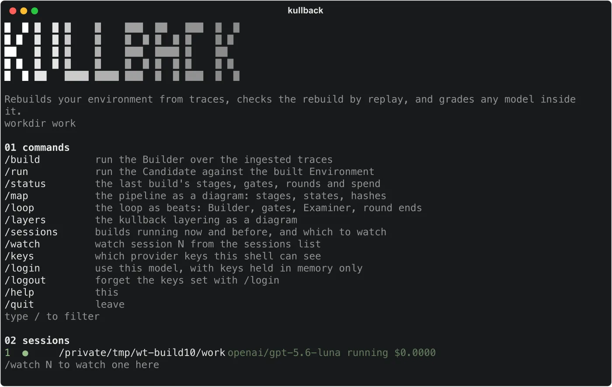

<div align="center">
  <h1>Kullback</h1>
  <p><strong>Rebuild an executable environment from your agent's traces, then grade models on it in code.</strong></p>
  <a href="LICENSE"></a>
  <a href="https://huggingface.co/leibler"></a>
  <br><br>
  
</div>

## What this is

Kullback turns the recorded conversations of a tool-using agent into a running copy of the system it worked in: a
database, tools, policy checks, a simulated user and a Verifier per Task. Any model can then be played through that
copy, and a Verifier decides in code, from the end state, whether the model did what the user asked. It is the
open-source harness behind [Leibler](https://leibler.dev).

## What we did

We rebuilt two Environments from the public [tau2-bench](https://github.com/sierra-research/tau2-bench) corpora and
released them on Hugging Face: [leibler/retail](https://huggingface.co/datasets/leibler/retail) with 223 Tasks and
[leibler/airline](https://huggingface.co/datasets/leibler/airline) with 130 Tasks. Every Task replays its recording in
the rebuilt world, and each Verifier is derived from the user's ask and the policy, never from the recorded answer.

## How to use it

```bash
git clone https://github.com/leiblerdev/kullback.git && cd kullback && uv sync
uv run kullback fetch leibler/retail --out env-retail
uv run kullback run --workdir env-retail --task <task id> --model provider/model
uv run kullback verdict --workdir env-retail
uv run kullback report --workdir env-retail
```

`fetch` checks the content hash, and `ls env-retail/tasks` lists the Task ids. `run` plays one model on one Task; live
calls need `HARNESS_ALLOW_MODEL_REQUESTS=1` and the provider's key (see `.env.example`). `verdict` scores the stored
Runs and `report` writes `report.md`. To build an Environment from your own traces, start with `kullback ingest` and
`kullback build`; [docs/trace-intake.md](docs/trace-intake.md) covers the trace formats, and
[docs/README.md](docs/README.md) lists every doc.

## Why it matters

Benchmarks written by hand are slow to make and rarely look like your own system. Your agent's traces already hold the
tools, the data and what users ask for. Kullback turns them into Tasks with checks in code, so you can compare models
on your own work, and train on it, without hand-writing a benchmark.

## Known issues

Some Tasks can be wrong. A Verifier can check the wrong thing, or a Task can be impossible to finish. Treat the result
of a single Task with care and the set as a whole as an eval. The decisions behind the harness are in
[docs/decision-log.md](docs/decision-log.md), and what comes next is in [docs/todo.md](docs/todo.md).

## Licence

Apache-2.0 for the harness and every package; each source corpus keeps its own licence (tau2-bench is MIT).
