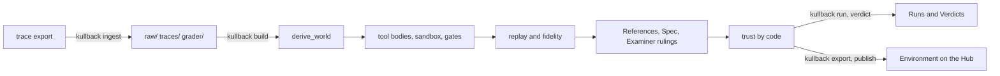

# Architecture

The map of the code under `kullback/`: what each package owns, the import contracts that keep packages apart,
and where each build stage lives. Read it before you change code, so a change lands in the package that owns it.
The boundaries matter because they keep an agent from grading its own work.

Every module has one line on the [module page](architecture/modules.md). Words like Task, Verifier and trusted
are defined in the [glossary](glossary.md). Why the code has this shape is in the [decisions](decisions.md)
and the [ADRs](adr/), ADR-0007 (two agents, gates no agent can write) and ADR-0011 (one core, one bus) first.

## Packages

| Package | What it owns |
|---|---|
| `ai` | Every model behind one `ModelProvider` contract: streaming, retries, caching, pricing, usage, replay handles. |
| `agent` | The application-free agent core after tau_agent: loop, harness, bus, sessions, compaction, base tools. |
| `runner` | Executes a Run and decides its Verdict in code: records, canon, routing, replay, budget, `world/`. |
| `gates` | Every accept-or-reject check, plain code, no model call; rulings go to `gates.json`. |
| `judge` | Judge items: one model call per Verifier item, score 0 or 1 (D328). |
| `user` | The Simulated user: rule-driven `SimulatedUser` and model-driven `AgentUser` with code guards. |
| `spec` | Mines each Task's Intent, writes its Verifier, runs the review loop, rules trust. |
| `examiner` | Chooses References and reviews each Spec with rulings; it writes no Verifier (D320, D331). |
| `builder` | Turns traces into an Environment as one autonomous session: ingest, mine, cluster, tool bodies. |
| `synth` | The scenario layer of the synthetic generator (D372 to D374). |
| `trainer` | The training agent behind `kullback train`. |
| `hub` | Exports a package or a Harbor dataset, renders cards, publishes and fetches. |
| `report` | The Markdown report, read from records; it never computes a Verdict. |
| `tui` | The terminal screen for one running build. |
| `cli.py` | The `kullback` command; each subcommand imports its module lazily. |

What each package imports today, read off the code with grimp (the graph library import-linter uses):

```
agent    -> ai
gates    -> runner
judge    -> ai, runner
runner   -> ai, gates, judge, laws, sampling
user     -> agent, ai, gates, runner
spec     -> agent, ai, claims, gates, judge, processes, runner, synth, user
examiner -> agent, ai, derive, gates, judge, runner, sampling, spec, variants
builder  -> agent, ai, examiner, gates, runner, sampling, spec, user
synth    -> agent, ai, builder, domain, examiner, runner, spec
trainer  -> agent, curriculum, runner, sampling, user
hub      -> ai, builder, difficulty, domain, gates, judge, processes, round_snapshot, runner, spec, synthesise
report   -> claims, difficulty, examiner, gates, round_snapshot, runner, user
tui      -> agent, ai, builder, runner
```

## Import contracts

`uv run lint-imports` checks nine contracts from `[tool.importlinter]` in `pyproject.toml`; the pre-commit hook
runs it. The first is a layers contract, top to bottom:

```
hub | trainer
builder
examiner
spec
user
agent
runner:gates
ai
```

A module imports only from layers below its own. `hub | trainer` are independent siblings. `runner:gates` are
siblings that may import each other: the world runs toolkits under the confinement gate, and the gates grade the
Runner's records. The other eight are forbidden contracts:

- `runner.world` imports neither `builder`, `examiner` nor `user`.
- `user` never imports `builder` or `examiner`.
- `gates` never imports `agent`.
- Nothing below the frontends imports `cli`, `tui` or `report`.
- `trainer` never imports `examiner`, `builder`, `hub` or `gates`, and nothing it learns from imports it back.
- `curriculum`, the training record format, imports nothing of the harness.

A second boundary is not import-linter's: `runner/boundary.py` scans `runner/` and `ai/` and refuses any import
of the Builder and any dynamic import (D89, D91).

## How a build runs

A build lives in one workdir. Single-file records are declared once in `kullback/store_specs.py`.



1. Ingest. Each file is stored byte for byte under `raw/`; Traces go to `traces/`, grader fields to `grader/`.
   `builder/ingest.py`, one adapter per format in `builder/sources/`.
2. Derive the world. Mine tools and schema, cluster Tasks by the user's ask, build the Starting state and the
   user rules. `builder/world_tools.py`, `builder/mine.py`, `builder/cluster.py`.
3. Tool bodies. One file per tool under `env/tools/`; every write passes the gates and runs in the sandbox.
   `builder/env_files.py`, `builder/sandbox.py`, `gates/hook.py`.
4. Replay. Each recorded Trace is replayed through the rebuilt world and scored call by call.
   `runner/replay.py`, `gates/fidelity.py`.
5. References. Code chooses each Task's References. `examiner/stage.py`, `examiner/reference.py`.
6. Spec. The Intent is mined from user turns; the Verifier is written from the Intent, the policy and the world.
   `spec/stage.py`, `spec/intent.py`, `spec/writer.py`.
7. Review. The Examiner files rulings; the writer applies or rebuts each, up to the round cap.
   `spec/rounds.py`, `spec/rulings.py`, `spec/review.py`.
8. Trust. A Task is trusted when the constructed Runs fail and no ruling is open, by code.
   `spec/trust.py`, `spec/mutants.py`, `spec/report.py`.
9. Runs. A Candidate plays a Task; `verdict` scores stored Runs and `regrade` re-scores them.
   `runner/tool.py`, `runner/verdict.py`, `runner/regrade.py`.
10. Publish. Export a package or a Harbor dataset after a leak scan, upload it as one tagged commit.
    `hub/package.py`, `hub/harbor.py`, `hub/publish.py`.

The session stops when every Task is trusted or refused, when the spend ceiling is reached, or when the model
says why it cannot go on (`builder/session.py`). The core appends every event to `bus.jsonl`; priced calls go to
the feed (`runner/feed.py`) that `kullback tui` and `kullback budget` read.

## One code hash

No agent may change the Runner or the gates during a build, because they grade the work (ADR-0007).
`gates.PROTECTED` refuses those paths to the agents. People change them by ordinary commits.

`runner/code_hash.py:CODE_HASH` is sha256 over the path and bytes of every `.py` file under `kullback/runner/`,
`kullback/gates/` and `kullback/spec/`. Every Run, Verdict and tier row carries it. Two numbers are comparable
only when their hashes match, so compare hashes before you explain a change in counts.
`kullback freeze-runner` records it in `runner_version.json` for the export manifest; it pins nothing.
